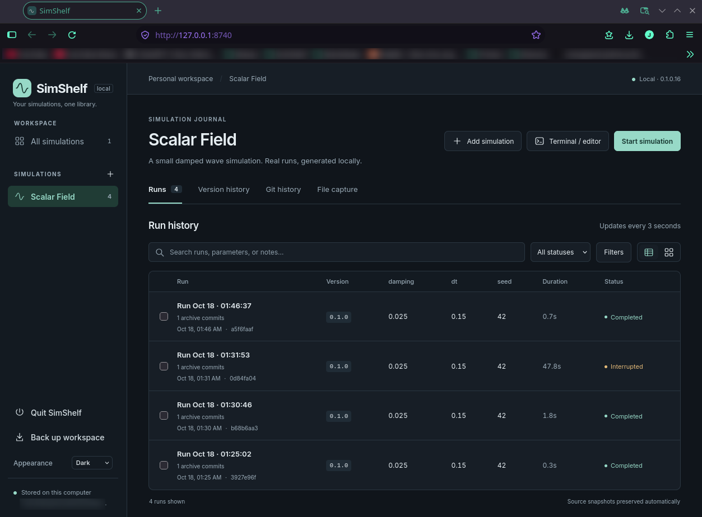
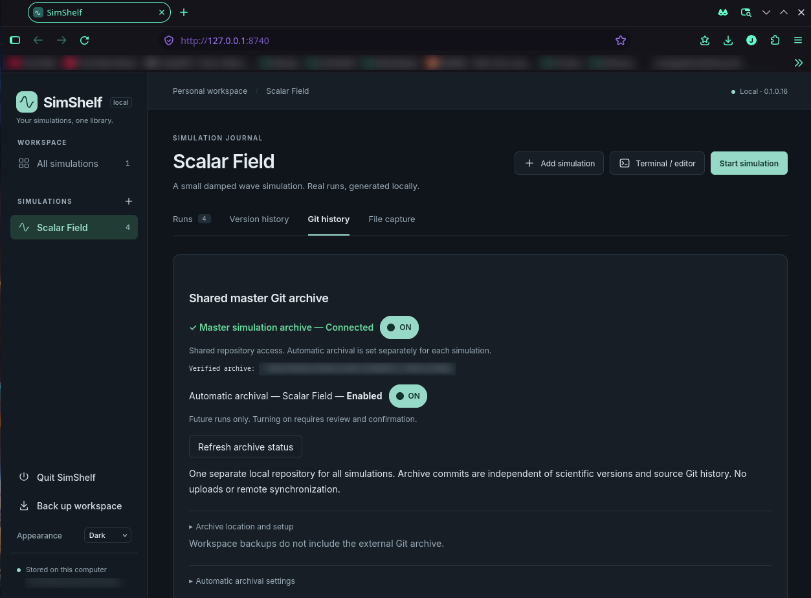
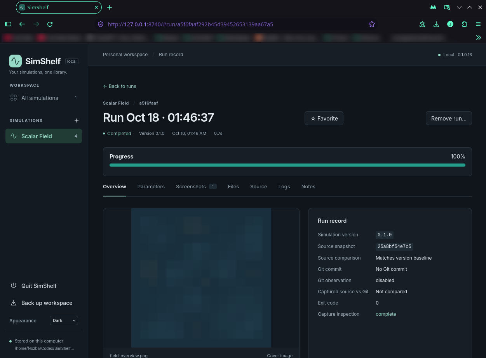

# SimShelf

**Your simulations, one library.**

> **Experimental software:** SimShelf is in early development. Bugs, incomplete
> preservation, incompatible updates and data loss are possible. Keep independent
> backups of original sources/results, your SimShelf library and any external Git
> archive. Reference-only files and the external archive are not included in a
> library backup. Independently verify measurements and captured outputs before
> using them for research. See [data protection and limitations](docs/DATA.md).

SimShelf is a free, local-first Python simulation library and run journal. Keep a
searchable history of experiments, their exact runtime arguments, reported
parameters and source context, so you can return to past work and compare runs.

## Interface preview

  
  
  

Earlier interface: run history · Git archive · Run record — select any image for full size

Current builds combine capture and archive choices in **Preservation settings**;
source development history is under **Source Git**.

**[Get started: open the portal and record your first run](docs/GETTING_STARTED.md)**

Register existing simulations and launch them from the local browser portal, or
keep recording from a terminal or editor. The portal can discover supported,
parameters declared in a root `swss.toml` (SWSS schema 2) and let you selectively override them; dynamic declarations
and some argument styles still need manual entry. Follow run status and reported
progress when available—progress detection is optional and not universal.

Review previous runs, source snapshots and copied or referenced results. Attach
screenshots and notes, compare recorded parameters, and keep scientific version
labels distinct from exact source identity. Snapshots preserve selected files;
they do not guarantee reproducibility or back up every external input/output.

## Requirements

- Python **3.11+**, Bash and a local browser. Runtime validation is on Linux
  (including Fedora) with Chromium; Windows, macOS and other browsers are unverified.
- Disk space for the application environment, library, retained files and backups.
  Storage depends on your capture choices; there is no validated minimum RAM/CPU
  or GPU specification. Scientific scripts have their own requirements.
- Setup normally needs network access to install Python dependencies. The portal
  and recording work locally afterward; Node.js is only needed for frontend development.
- Git is optional for recording. Source Git history and the shared Git archive need
  a usable `git` executable on the server's PATH. See [setup and dependency
  guidance](docs/GETTING_STARTED.md#requirements-and-dependency-help).

From a checkout, `./start.sh --setup` explicitly installs SimShelf's dedicated
environment; `./start.sh` opens the portal. This does not install scientific
packages into simulation interpreters. Follow the guide for a disposable first run.

## One preservation workflow

The local library is always active. **Master Git Archive** in workspace navigation
has one global ON/OFF switch; **Archive this simulation** is each simulation’s
only participation switch. First activation includes explicit scope review.
Use **Preservation settings** to configure capture and Git inclusion together.
Recursive copied JSON/CSV/log output can include simulation-created subdirectories.
Run views separate execution, capture and Git completeness; later notes and
captions require explicit append-only review. Keep selected evidence in a
shared local archive, with separate per-run commits and exact historical file
downloads. Git is not cloud storage: local commits upload nothing. Repeated large
binary results such as NPZ/WVZ files can rapidly grow history and slow cloning,
backup and maintenance; overwriting a file does not erase earlier Git objects.
Use normal copy/reference workflows or suitable external storage for large data.
See [archive selection, limits and recovery](docs/GIT_ARCHIVE.md).

## Documentation

- [Getting started](docs/GETTING_STARTED.md): a first run and dependency troubleshooting.
- [User guides](docs/README.md#user-guides): setup, recording, capture, backups and Git.
- [Technical references](docs/README.md#technical-references): architecture, versions,
  development and validation evidence.

SimShelf is a single-user localhost application. Remote hosting, remote Git
synchronization and automatic scientific-environment installation are not supported.
Testing is not production certification; see [validation and known limits](docs/VALIDATION.md).

## License

SimShelf is available under the [MIT license](LICENSE).
Bundled dependencies retain their [third-party notices](THIRD_PARTY_NOTICES.md).
