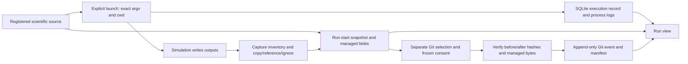

# Issue #118 — one library, one local preservation workflow

**Status: Phase 1 proposal for owner review; Phase 2 is not approved or implemented.**
Audit base: SimShelf `40fa289509f99aad80d2d4dc3ac89663bb2b91e5`, application
`0.1.0.42`, 2026-10-21. The [audit report](validation/issue-118-library-preservation-audit.md)
contains the inspected historical commit, byte checks and repeatable tests.
Earlier [#47](GIT_ARCHIVE_DESIGN.md) and [#56](MASTER_ARCHIVE_UX_DESIGN.md)
designs/reports retain their historical meaning. This proposal replaces neither
accepted behavior nor old evidence merely by being committed.

## What the investigation establishes

The reported run completed and copied three outputs (3,030 bytes) into the
library. Its initial Git commit `fd164a95221f8f299d1fdb70c9603ffaa9a11e8c`
added **one manifest, zero source payloads and zero output payloads**. That
manifest has both `files: []` and `skipped: []`. The complete commit tree contains
29 files, including earlier events: the entire archive is not empty. All three
managed copies match their recorded hashes and the still-existing originals.
The two source files are also present and verified in the library snapshot.

This is an inclusion/coverage and presentation problem, not evidence of lost
managed copies or failed Git writes. Current code allows an empty selected set
to publish successfully, and labels the event “Initial run archive” without a
file-count qualification. Omission reporting covers selected candidates, not all
captured evidence. Therefore an empty omission list is not proof of completeness.

Capture and archival use separate policies. Ordinary capture recursively copies
eligible new/changed JSON and log files. Archive selection is the union of source
file/folder/extension preferences and separately consented future-output patterns.
Those patterns only permit wildcards in the final filename. `*.json` does not
match `run_<id>/summary.json`; `outputs/*.json` means another `outputs` directory
inside the capture parent. `run_*/*.json` and `**/*.json` are rejected.

The recorded run froze **no future rules**. Its finalized state no longer retains
the complete initial selection plan, so today's saved settings cannot prove every
rule used then. Today's empty source rules and six shallow future rules are a
separate observation. Tests independently reproduce empty, source-only and
shallow-pattern commits. Existing extension preferences do select nested files;
they are not clearly presented as one run-evidence preservation policy.

## Current flow and ownership

| Stage | Current implementation and boundary |
| --- | --- |
| Registration | `Store.add_simulation` records identity, source root, entrypoint and capture settings. It neither runs the simulation nor grants archive consent. |
| Launch | `Run.__enter__` checks source/metadata, captures startup source bytes, observes outputs and freezes any valid archive plan. `record_command` runs exact argv with `shell=False`; it does not run from the snapshot. |
| Capture | `capture.output_inventory` scans the frozen root without following output symlinks. `capture_outputs` compares size/mtime and applies copy/reference/ignore, budgets and any frozen future-copy overrides. Source capture excludes generated output trees. |
| Library retention | SQLite/journal records, `snapshots/<snapshot-id>.json`, `blobs/<first-two-hash-characters>/<sha256>` and `logs/<run-id>/{stdout,stderr}.log` retain different kinds of evidence. A reference records a location, not its bytes. |
| Archive preparation | `git_archive.prepare` checks location-bound consent, configuration, source selection and archive identity; selected outputs receive bounded startup fingerprints. Optional failure does not replace scientific execution status. |
| Finalization | `finalize` selects snapshot bytes and changed outputs with verified automatic managed copies. It persists a pending manifest after execution/final capture; it never substitutes current source for snapshot bytes. Unselected files do not appear in `skipped`. |
| Git publication | `publish` loads the preceding tree, appends unique event paths, and atomically updates `main` plus an operation ref. It verifies manifest and payload hashes before associating the commit in SQLite. Other simulations' older paths remain in each new tree. |
| Retrieval | Run Files joins artifacts and Git entries by identity/hash/size. Downloads resolve the recorded event/commit/path and verify bytes. Neither current HEAD nor a live source file is a substitute. Source/Notes/Screenshots are different projections of the same run. |
| Backup | Workspace backup includes database associations, retained snapshot/artifact blobs and frozen process logs. It does not include the external Git objects or reference-only originals. Git alone cannot currently reconstruct a complete SimShelf library. |

Git paths are
`simulations/<simulation-id>/runs/<run-id>/<operation-id>/<entry-index>/<basename>`;
each operation also has `manifest.json`. Repeated names and later revisions get
new paths. File modes in the archive are currently normalized to `100644`; the
source snapshot retains its own mode metadata. Byte identity is not a promise
that Git alone restores original permissions or an executable environment.

## Alternatives and recommendation

| Alternative | Benefit | Cost / decision |
| --- | --- | --- |
| Library store is the only archive; Git remains an optional export | Smallest storage change; full current database/backup behavior retained | Does not fulfill the requested durable local master Git archive experience; leaves export policy divergence unless substantially redesigned. |
| Git replaces SQLite and managed blobs | One physical store | Requires a new query/recovery model, migration and different backup/retention semantics; risks scientific history. Reject for this issue. |
| One library with an optional local Git preservation backend | Retains current capture/index/recovery and shared append-only Git; one policy and one evidence inventory | Requires explicit policy review and new truthful coverage records. **Recommended.** |

Use **SimShelf Library** as the user-facing collection. Its library directory
remains authoritative for operational queries, original execution records,
annotation history and recovery intent. When the user enables local Git
preservation, the dedicated Git archive is the durable, versioned authority for
the **specific evidence bytes and record revisions verified in each event**.
Neither store is presented as a complete substitute for the other. The same
run/evidence identity links both; inconsistent or missing bytes cause an explicit
integrity state, never last-writer-wins reconciliation.

Until there is an independently tested import/restore facility, restoring the
whole application still requires a library backup and the external Git repository.
Git evidence must remain independently inspectable with ordinary local Git and
documented SHA-256 checks. Do not describe this as full restoration from Git.

Archive-free use remains supported as **Local library only — Git preservation
not enabled**. A configured but disconnected archive says **Git unavailable —
new runs retained locally only**, with an explicit reason. Disconnection is not
deletion, a new permission grant, or evidence that prior Git objects are gone.

## Proposed reviewed policy for future runs

One **Preservation settings** review per simulation should describe the complete
path from capture to Git. The shared archive connection belongs at library level;
optional source Git provenance remains separate from preservation. Do not require
an original source repository or implement source-repository initialization (#45).

The proposed new policy offers:

1. The existing source snapshot selection, with excluded/generated paths visible.
   The proposed default is all captured source entries, subject to the existing
   archive limits; the owner/user must review this expansion from any old rules.
2. A capture-relative recursive set of eligible managed output copies. Proposed
   default types are `.json`, `.csv`, `.log`; show matching current examples and
   explicitly state that future descendants are included. No path-name ownership
   inference, live external scan, scientific-format conversion or script adapter.
3. Copy/reference/ignore and Git inclusion decisions in the same review. An
   existing reference/ignore remains that way until explicitly changed. The new
   policy should consume verified managed copies without a second hidden copy
   override; show which proposed capture-rule edits enable missing evidence.
4. Exact limits and an estimated current size, with future size unknown. Show
   every available reason for exclusion and explain that large binaries remain
   outside the default Git set. Screenshot bytes require their separate deliberate
   post-run inclusion; no automatic archival of all attachments.
5. An explicit frozen revision binding source location, capture settings, archive
   identity, selection and consent. Changing it affects future runs; active plans
   and old commits remain fixed. Cancel or failure leaves prior consent intact.

Introduce a new, versioned application-local policy only after approval. Do not
reinterpret old future patterns as recursive or silently convert saved preferences.
Existing consent continues with its legacy semantics and is labeled as such until
the user reviews the proposed replacement. One review replaces the duplicated
control path for that simulation; old run evidence stays readable. Explicitly
disabling future preservation does not erase prior commits or change active plans.

For new plans, preserve the existing safe inventory/hash/copy checks and bounds.
Select eligible descendants before before/after hashing, then require a matching
run-specific managed artifact. Do not publish unrelated old siblings merely
because they now match a recursive rule. An empty or unavailable initial inventory,
unchanged bytes, race, skipped copy or budget exhaustion must not masquerade as
verified complete preservation. Known omissions and scan-truncated unknown
coverage need separate representations; unknown coverage can never pass completeness.

## Evidence inventory and completeness

Every run should answer three separate questions, visible together:

| Axis | Proposed truthful display |
| --- | --- |
| Execution | Completed / failed / interrupted, genuine exit code and timestamps. |
| Capture | Copied / referenced / ignored / skipped counts, root, errors and unknown coverage. “Complete” retains its bounded capture meaning, not all possible scientific outputs. |
| Local Git preservation | Not enabled / unavailable / pending / failed / partial / verified for reviewed scope, with source/output/record counts, policy revision, exact commits, omissions and unknown coverage. |

For the historical reported run the summary should be: **Completed; capture
3 copied; Git 0 of these 3 captured outputs, 0 source files — manifest only**.
The row is neither an empty repository nor complete run preservation. Historical
coverage may be derived from immutable artifact/event identities; absent old
policy details stay unknown. Never rewrite its manifest or invent an old plan.

The inventory should start from the run's snapshot and artifacts plus retained
capture diagnostics, then associate archive entries by identity/hash/size. Each
item records one disposition: verified in Git; locally retained but not selected;
requested but missing/unsafe/over budget; reference only; ignored/not retained;
or unknown. Stable IDs and per-event revisions prevent filename-only joins.
Counts describe this run/event, not the cumulative full Git tree.

An explicit empty selection should be refused as an “archive my run” activation,
or require a clearly labeled metadata-only policy; it must never receive a green
complete-evidence summary. Recommended Phase 2 choice: refuse new empty policies.
Source-only scopes may be deliberate but must say “source only; outputs not
selected.” A successful commit with any required item missing is partial.
“Verified for reviewed scope” is allowed only after every requested item and the
record envelope have been verified and no inventory uncertainty remains.

Each file has one primary retrieval action with its actual source labeled:
**Download retained file** or **Download Git revision**. Details expose both copies,
hash, size, logical path and exact Git address. A corrupt/unavailable source fails
explicitly; a user can deliberately choose another verified copy. Source uses
snapshot identities; archived-only revisions remain visible when a managed
attachment was deliberately deleted. Notes and Screenshots use this same evidence
status rather than inventing separate archives.

## New event record and later annotations

New Git events need a versioned **SimShelf-local preservation record** beside the
selected bytes. This is an application export, not a replacement for SWSS or a
new cross-tool contract. Existing simulation-authored provenance/log files remain
unmodified payloads. Any later proposal for portable shared semantics must follow
the repository's SWSS escalation rule before implementation.

Proposed fields for the initial event:

- Existing simulation/run/operation identity, kind/time and prior event identity.
- Original exact argv token array (including empty tokens and numeric spelling),
  cwd and source-location context explicitly marked as machine-local; genuine
  outcome/exit code/time; simulation version, snapshot ID and recorded parameters
  with their sources. Preserve unknown/absent fields; never infer resolved values.
- Original source manifest identities, byte hashes, sizes and recorded modes;
  selected copied source/configuration and output bytes with artifact identity.
- Separate capture outcome and policy-relative Git disposition ledger, including
  exclusions, unavailable required items and truncated/unknown inventory.
- Explicit exclusions for environment recreation, external references, uncaptured
  outputs and other evidence absent from this event. Process stdout/stderr are
  distinct from scientific `.log` output and need their own reviewed inclusion.

Freeze the payload before publication in durable pending state; serialize stable
UTF-8 JSON with deterministic keys/list ordering. Metadata can reveal local paths
or research values, so its exact inclusion is visible during local consent. No
silent redaction/coercion of the authoritative run. Remote publication is outside
this proposal and later requires review of all reachable historical content.

Suggested bounds for review: 1 MiB record/annotation payload per event, 64 KiB per
individual note/caption, 1,000 annotation entries per run, charged against the
existing cumulative 100 MiB. Oversized records fail visibly without truncation;
these bounds are proposals, not current guarantees. Retain the existing 1,000
file entries and 25 MiB/file limits, including revisions/additions.

Screenshots and manual files continue to require reviewed append-only additions.
An addition includes selected bytes plus the reviewed caption/note revision,
stable annotation identity/time, author context if actually recorded, and the
original run/event association. A later edit creates another approved event; it
cannot amend the original run or commit. Historical notes/captions currently only
in the database remain labeled locally retained until explicitly exported.
Attachment upload or note editing alone does not grant Git publication consent.

## Recovery, compatibility and backup

- Reuse workspace lock → archive lock ordering, immutable pending intent,
  operation refs, conditional ref updates and manifest/payload verification.
  Publish-before-database crashes associate the existing verified event on retry;
  retry never recollects a live output directory or creates duplicate commits.
- Record failed/pending preservation independently of execution. Without durable
  candidate intent, recovery reports incomplete and offers a separately reviewed
  export of still-verifiable managed evidence. Historical runs never acquire a
  fabricated original archive after reconnection.
- Disabled, disconnected, wrong-identity, missing-path, no-Git, corrupt-object,
  insufficient-space and lock-contention states remain distinct. Connections do
  not confer consent and switching repositories does not relocate existing events.
- New metadata should use additive versioned namespaces and leave completed rows,
  old consent/plans, blob hashes, journal history, permissions and Git refs intact.
  Older applications must not interpret new consent as legacy approval. Confirm
  backup/restore retention for new pending/annotation data before accepting this
  approach. If an incompatible schema becomes necessary, stop for a separate
  migration proposal with backup/restore and interruption evidence.
- Keep workspace backup semantics unchanged and explicit: it includes ordinary
  managed evidence and archive associations but excludes external Git objects and
  referenced originals. A future combined backup command is not included here.
  Demonstrate restoration into a fresh directory plus reconnection to a separately
  preserved archive. No pruning, repacking, erasure or destructive consolidation.

## Separate output-allocation decision

Accepted [SWSS v2.0](https://github.com/mongstad/Simulation-Standards/blob/285ab0d6c06cc3b88e421a2c00577e72c650c750/standards/SWSS/v2.0.md)
§2 requires unique simulation outputs; §3.1 is an optional coordinated capability
requiring agreement on a single effective root. Baseline/parameter support is
not an acknowledgement of SimShelf's environment variables.

The pinned scalar-decay **0.1.3** fixture independently creates its unique child
under `--output-parent`. Fixed parent capture watches that subtree and captures
its three files. SimShelf `per_run` allocates a different sibling that this
simulation does not use: execution succeeds, copied count is zero, and the
missing required log yields partial capture. Both cases were run in disposable
copies. Changing Git selection cannot repair a wrong capture root.

Treat launch-time capability/ownership validation as a distinct correction before
implementing it: propose an explicit SimShelf-side review for choosing fixed
parent capture versus a separately supported coordinated launcher root. Preserve
existing cooperating callers and require evidence of their contract. Do not
auto-detect acknowledgement from `swss.toml`, directory existence, emptiness or
stdout, rewrite argv, weaken overlap guards, make scripts read SimShelf variables,
or amend SWSS/reference code. Fixed-parent same-simulation overlap remains
restricted; this design does not promise concurrent independent capture there.
If a new portable root acknowledgement protocol is needed, propose separately
authorized standards work rather than inventing an extension here. No separate
issue has been created and no allocation change is included in Phase 1.

## Owner decision and Phase 2 acceptance gate

Approve or revise the recommended two-store implementation of **one library**,
the single reviewed future policy, the exact record/annotation export scope and
bounds, and the separately gated output-allocation correction. A Phase 1 review
does not itself approve storage migration, remote sync or publication. Retain
this draft PR until the agreed Phase 2 behavior has been implemented and checked;
the closing reference must not be used to imply Phase 1 completes the whole issue.

After approval, one focused implementation on the same issue branch must show:

| Area | Required verification before owner acceptance |
| --- | --- |
| Selection and completeness | First/repeat nested log/JSON/CSV runs; reviewed omissions/reference/ignore; source-only/empty/legacy plans; every count reconciles to manifest and actual commit bytes; genuine exact argv/provenance/outcome. |
| Identity and concurrency | A/B/A plus concurrent distinct simulations and supported distinct roots; same-simulation overlapping fixed roots still rejected; historical bytes/IDs/permissions unchanged after HEAD advances. |
| Lifecycle | Disabled/disconnected/reconnected/wrong archive; process failure and cancellation; no-Git/disk/budget/unsafe-link failures; crash before/after publication; idempotent retry and application restart. |
| Later evidence | Manual screenshots/files and note/caption edits; explicit reviewed append-only revisions; limits and stale review rejection; deliberate managed deletion does not erase Git. |
| Recovery and backup | Fresh backup/restore with pending and completed events; separate Git copy/reconnection; original external sources/references untouched; Git-only inspection does not promise library restore. |
| User workflow | Run Files/Source/Notes/Screenshots and master view agree, source-only/empty events cannot look complete; keyboard, narrow/desktop and packaged browser checks; real downloads verified by hash. |
| Delivery | No runtime release in Phase 1; Phase 2 gets the then-current accepted-main version increment, focused failures/skips, package/runtime checks, and owner verification. Stop for owner review. |

No remote connection/push/sync (#49), standards change, scientific algorithm
change, source adapter, historical rewrite or destructive cleanup is authorized.
