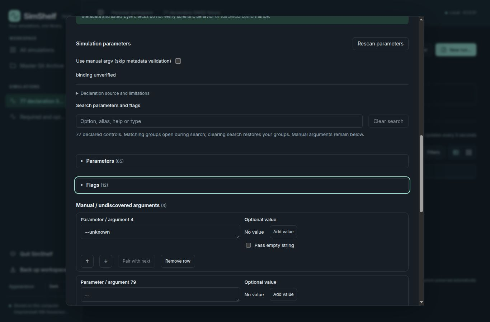
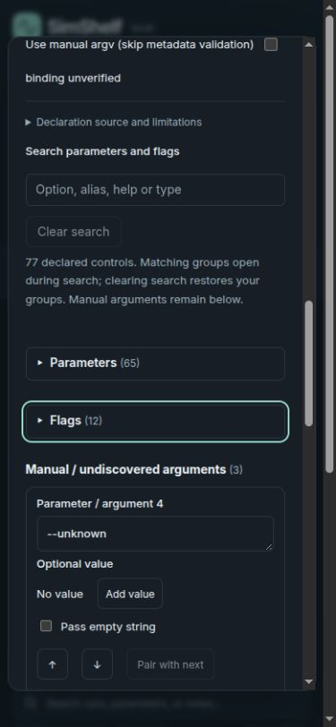
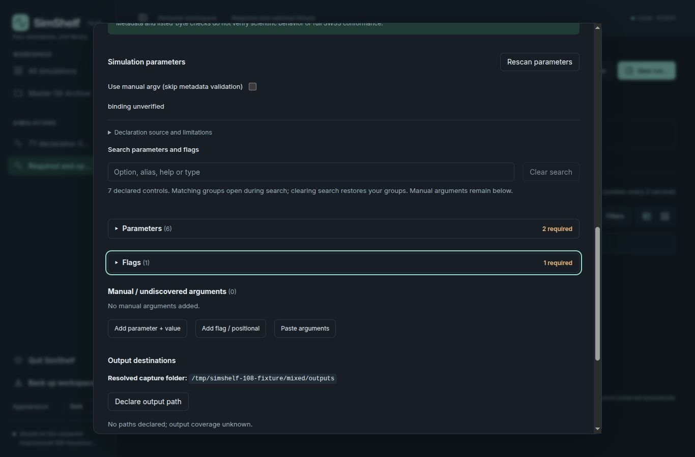
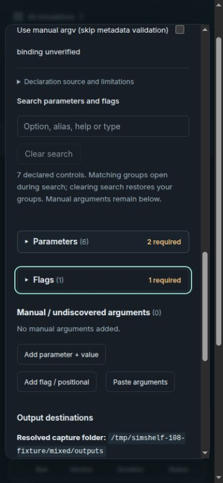

# Issue #108: collapsed parameter and flag groups

Validated on Linux/Chromium, 2026-10-23, against accepted main `89b4416`
(0.1.0.50), with proposed application version 0.1.0.51.

## Behavior and implementation

New run starts with Parameters and Flags collapsed. Each native button exposes
expanded state, its controlled content, a chevron, total count and required count.
Required controls lead their collection without reordering argument storage.
Absent collections have no header; manual/undiscovered arguments remain separate
and visible. Hidden controls stay mounted, preserving drafts.

Search temporarily opens both existing collections and filters their controls.
During search, disclosure buttons announce `aria-disabled` and cannot hide matches.
Clearing search restores the user's previous expansion choices. Missing-required
validation clears search, opens affected collections and focuses the first missing
control. Closing and reopening New run resets disclosure state.

Changed code: `frontend/ArgumentEditor.tsx`, `parameterPresentation.ts`, its tests,
and `style.css`; regenerated distributed app.js/app.css; incremented `_version.py`.
No argument conversion, backend, storage, SWSS or scientific execution changes.

## Automated and installed-package checks

- `tsc --noEmit` and frontend build passed.
- Bundled with esbuild for Node, then executed the parameterPresentation,
  parameters, arguments and ParameterHint test files: **37 tests passed**.
  Coverage includes required-first display with original edit indexes, absent
  collections, search counts, aliases, repeats, numeric spelling, empty strings,
  manual arguments and `--` preservation.
- `PYTHONPATH=src PYTHONDONTWRITEBYTECODE=1` with the development interpreter:
  `python -m pytest -p no:cacheprovider --basetemp=/tmp/simshelf-108-pytest
  tests/test_application_version.py tests/test_parameters.py`: **16 passed**.
  Existing Starlette/httpx deprecation warning observed.
- Built wheel and sdist externally, rebuilt wheel from extracted sdist, and
  compared wheel member names and bytes: identical. Distributed JS/CSS and legal
  notices match checkout. Installed into a disposable target with existing runtime
  dependencies; Python, CLI, API and OpenAPI report 0.1.0.51.
- Installed TestClient startup/API/static checks passed with Git/Node absent from
  PATH and Python socket connect/connect_ex denied. This is an in-process outbound
  network check, not an OS network isolation test; CLI version subprocess was
  outside the socket patch.
- `git diff --check` passed. Version gate uses freshly fetched `origin/main`.

## Browser and argv evidence

Used disposable fixtures outside the checkout. The original parameter_list.py
fixture failed at registration because its per_run policy is rejected by the
accepted SWSS policy check. An external copy used fixed policy and added a
required flag to the mixed fixture; repository fixtures were not changed.

The 77-declaration fixture has 65 values and 12 flags. Checked collapsed opening,
Enter/Space toggling, Tab focus, editing, collapsing, alias search, no matches,
clearing search, save and reopening. Save preserved the expected exact argv:

```python
['--queue-zmin', '00256', '--diag-dt=1e-3', '--snapshot-times', '',
 '--unknown', '--no-plots', '--', '--no-plots']
```

Only the intentional numeric edit and enabled flag changed the original argv.
No simulation was launched. The mixed fixture has six values (two required) and
one required flag. With saved argv omitted, validation opened both groups and
focused `Value for --queue-zmin`; repeated missing-flag validation after collapse
and a no-match search cleared search, reopened Flags and focused its enable box.
Existing empty numeric input validation semantics remain unchanged.

Checked collapsed mixed headers in Light, Dark, Onyx, Slate and Linen at 1366 px
desktop and 390 px narrow width: no document horizontal overflow. Installed-wheel
browser checks passed; browser console contained no errors.

| Fixture | Desktop | Narrow |
| --- | --- | --- |
| 77 declarations |  |  |
| Required and optional |  |  |

## Owner verification and limits

1. Open New run with declared values and flags. Confirm both groups start closed,
   counts remain visible, and required controls lead each opened group.
2. Use Tab, Enter and Space on the headers. Confirm focus is visible and content
   follows the announced expanded state.
3. Edit a value/flag, collapse it, search an alias or help text, then clear search.
   Confirm matches appear, prior expansion returns, and command preview retains
   the edits. Check a no-match search and manual arguments below the groups.
4. Omit required inputs and validate. Confirm affected groups open and focus moves
   to the first omission. Save settings, reopen, and confirm both start collapsed.
5. Review desktop/narrow presentation in preferred themes and inspect exact argv,
   including empty strings and the delimiter, before any owner-authorized run.

No real scientific workload, screen-reader evaluation, non-Linux platform,
alternative browser engine or full backend suite was exercised. Package checks
used existing dependencies, not a fresh dependency resolution. Historical reports,
user workspaces, databases, source snapshots and outputs were not modified.
