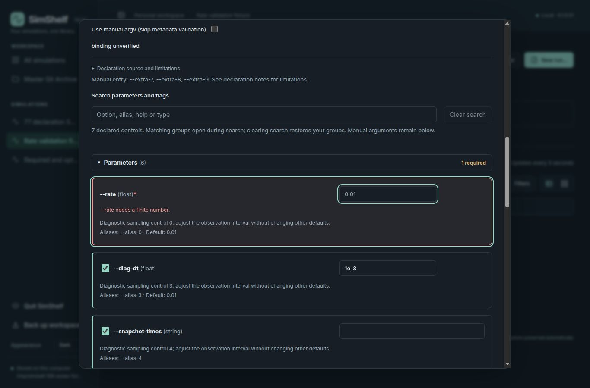
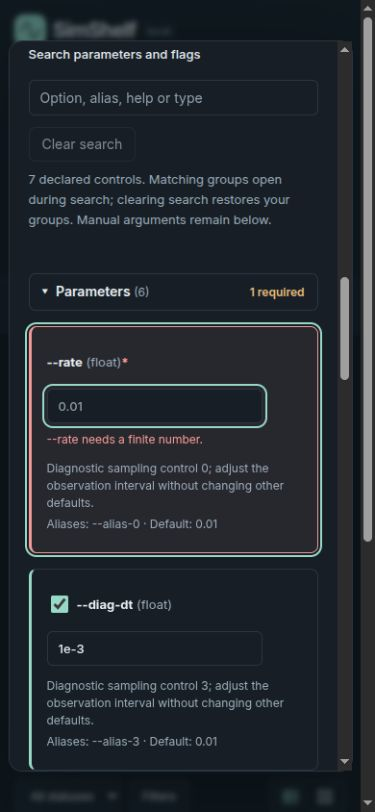

# Issue #108: invalid-control reveal correction

Owner-review revision, 2026-10-24. PR #136 remains on its existing branch;
accepted main is `89b4416`, proposed version remains **0.1.0.51**.
The original report and screenshots remain unchanged historical evidence.

## Reproduction and correction

Reproduced before editing: an explicitly empty required float produced
`--queue-zmin needs a finite number.`, while Parameters stayed collapsed and
focus remained on Validate interpreter & paths. The earlier reveal projection
recognized only omissions, not supplied invalid values.

`invalidParameterRows` now associates the existing validator's messages with
unambiguous typed controls. ArgumentEditor uses those errors to clear search,
open affected collections, and focus the first offending value/select or flag
checkbox after rendering. Repeated validation works after recollapsing or
filtering. Errors appear beside the control, with `aria-invalid` and
`aria-describedby`; correcting the value clears the inline error. The existing
validator, manual/ambiguous fallback, SWSS rules and argv conversion are unchanged.

## Regression results

- **39 Node tests passed**: parameterPresentation (7), parameters (20), arguments
  (4), ParameterHint (8). New checks cover omitted/empty/NaN/Infinity values,
  choices, disabled drafts, manual ambiguity and byte-for-byte argv retention.
- **6 real React/DOM browser cases passed** in
  `frontend/parameterValidation.browser.test.mjs`. Assertions check actual
  `document.activeElement`, hidden ancestors, expanded groups, error association,
  active search clearing, repeated validation, correction, required flag focus,
  and exact aliases/empty strings/manual tokens/delimiter preservation.
- Full-app browser reproduction passed with both empty-value and missing-flag
  errors. Installed-wheel `--rate=` checks passed at **1366×900** and **390×844**:
  Parameters opens, search clears, focus lands on the empty rate input, and
  `--rate needs a finite number.` is associated with that input. No horizontal
  document overflow. The displayed `0.01` is a placeholder, not a supplied value.
- Native keyboard checks: Enter/Space toggle headers; Enter activates validation;
  repeated validation restores input focus; Shift+Tab reaches the Parameters
  header and Tab returns to the first rate input. Browser console: no errors.
- **16 focused Python tests passed** (`test_application_version.py` and
  `test_parameters.py`), with the existing Starlette/httpx deprecation warning.
- `tsc --noEmit`, `node frontend/build.mjs`, and diff checks passed. JS/CSS were
  rebuilt; third-party notices unchanged. The initial `npm run` invocation failed
  because npm is absent; direct installed TypeScript/Node commands succeeded.
- External wheel/sdist builds and wheel rebuild from sdist passed. Wheel member
  names and bytes matched; packaged assets/notices matched checkout. Installed
  Python, CLI, API, OpenAPI and static checks passed with Git/Node absent from
  PATH and in-process socket connect/connect_ex denied. This is not OS network
  isolation; the CLI version subprocess was outside the socket patch.

The first harness attempt validated before its mocked declaration response had
settled; adding an explicit fixture settling step yielded six passing cases.
Early viewport captures affected the other open test tab; final captures below
were taken after closing that tab and verifying the full app's actual dimensions.
All libraries, sources, builds and test artifacts were disposable external paths.
No simulation was executed or user data modified.

## Repeatable DOM fixture

From the checkout, with the development Node binary on PATH:

```sh
mkdir -p /tmp/simshelf-108-focus
node_modules/.bin/esbuild frontend/parameterValidation.browser.test.mjs --bundle --outfile=/tmp/simshelf-108-focus/test.js
```

Create `/tmp/simshelf-108-focus/index.html` containing:

```html
<!doctype html><html><head><meta name="viewport" content="width=device-width,initial-scale=1">
<link rel="stylesheet" href="test.css"></head><body>
<button id="run-tests">Run regression tests</button><pre id="results"></pre>
<div id="root"></div><script src="test.js"></script></body></html>
```

Serve that directory on loopback with `python -m http.server 8109 --bind 127.0.0.1
--directory /tmp/simshelf-108-focus`. Open the local page, activate Run regression
tests and expect **ALL 6 PASSED**. This harness uses fixture discovery responses;
the installed full-app checks above additionally exercise the real discovery API.

## Owner verification

1. Open New run with a required numeric option supplied as `--rate=`. Leave
   Parameters collapsed and activate Validate interpreter & paths using Enter.
   Expect expansion, focus in rate, and its finite-number error beside the field.
2. Collapse again, search an unrelated flag, and validate twice. Search must clear
   and rate must receive focus each time. Compare exact argv before/after.
3. Repeat with the required option omitted and with a missing required flag.
   Confirm the correct collection opens and value/select/flag receives focus.
4. Correct the value; check the inline error clears. Use Tab, Shift+Tab, Enter and
   Space at desktop/narrow widths. Inspect the preview before any authorized run.




Limits: Linux/Chromium, Dark theme for this revision; other themes were covered by
the original PR checks, not rerun here. No screen reader, other OS/browser engine,
real scientific workload, full backend suite or fresh dependency-resolution test.
Manual/ambiguous argv keeps its existing summary validation and is not assigned
to a guessed typed control. No release or merge was performed.
