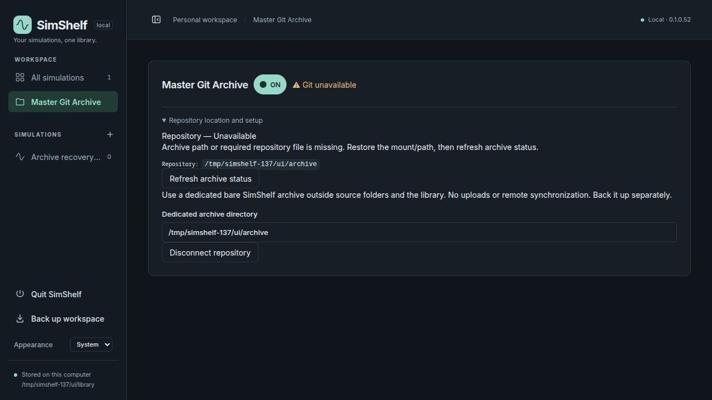
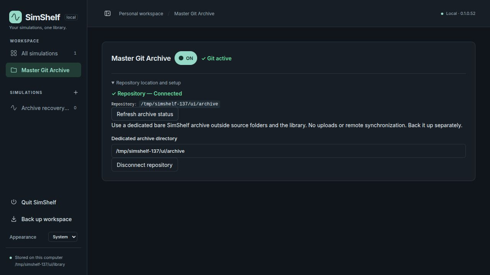
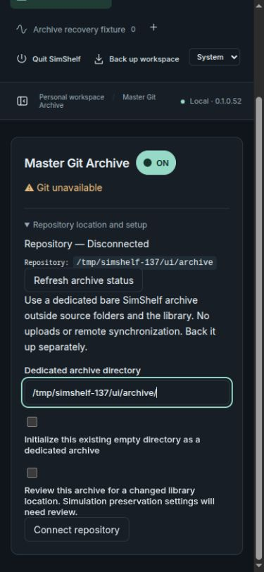

# Issue #137: archive availability and restart bindings

Validated 2026-10-24 on Linux/Chromium. Base: accepted main `1ee2b99`
(0.1.0.51); proposed version **0.1.0.52**. Existing issue-linked branch used.

## Investigation

The owner confirmed the archive was already reconnected. A read-only SQLite
inspection of the default library found two historical workspace-binding hashes.
Both could be reproduced with the same current hostname, canonical library path
and inode, changing only the device number: **36 versus 47**. The library is on
Btrfs. This is direct evidence of device-number-dependent binding drift, though
we did not observe the original boot event or perform a machine reboot.

The old workspace hash included hostname/path/st_dev/inode. Refresh recomputed it
and refused the old binding before inspecting the archive. Separately, the UI
supplied expected_connection only for exact raw path-text equality. Appending `/`
omitted that stricter check and allowed the explicit setup path to adopt the new
workspace binding; the repository's marker did not need to change. Simulation
consent then disagreed with the newly saved workspace binding. Backend directory
normalization itself already removed trailing slashes.

The repair preserves verified legacy tokens through auxiliary Btrfs location
anchors, adds distinct missing-path/access/binding diagnostics, and applies the
same remembered-path checks regardless of slash spelling. Deliberate remapping
has a separate checkbox/API boolean, reset when the entered path changes.
No automatic disconnect, repository initialization, consent replacement, Git
history edit, schema migration or scientific-data conversion is introduced.

Filesystem IDs are not a universal portable identity guarantee. See the
[Linux statfs contract](https://www.man7.org/linux/man-pages/man2/statfs.2.html)
and the [Btrfs maintainers' f_fsid derivation change](https://lkml.iu.edu/2608.3/14257.html).
The correction is scoped to Btrfs device renumbering with stable filesystem ID;
changed filesystem IDs remain failures requiring review.

## Validation

- **115 focused Python checks passed; 1 skipped.** Suites: git_archive,
  preservation, git_provenance, git_selection, application_version. The skip is
  the pinned standalone decay reference fixture (path not supplied); existing
  Starlette/httpx deprecation warning remains.
- New coverage: both slash forms, Store reload and a fresh Python process,
  controlled boot-like device renumbering with stable filesystem identity,
  unchanged modern policy and connection bytes, missing-directory restoration,
  denied-access/Git-unavailable recovery, source/master propagation, and refusal
  of changed filesystem identity even when device/inode are reused. An unverified
  binding cannot seed a trusted anchor.
- Existing tests cover historical downloads, archive events and run records,
  restored libraries, active plans, replacement repositories, symlinks, consent,
  interrupted operations and archive authorization. Restored-library tests now
  explicitly opt into remapping. An early run exposed three failures: two restore
  tests needed that explicit consent, and the server initially overwrote a supplied
  expected binding; the latter was corrected before rerunning successfully.
- The final sandboxed rerun stalled after seven checks and was terminated. The
  same suite outside the sandbox completed in 20.86 seconds with the results
  above, using disposable data. A no-isolation packaging attempt lacked
  setuptools; isolated builds then succeeded without changing the app interpreter.
- TypeScript and frontend build passed; distributed JS rebuilt and notices
  preserved. Version gate and diff checks passed.
- Wheel/sdist built externally; sdist-rebuilt wheel has identical members/bytes.
  Installed Python/CLI/API/OpenAPI/static assets passed with Git/Node absent from
  PATH and socket connect/connect_ex denied during in-process startup. CLI version
  subprocess was outside that patch; this is not OS network isolation.
- An initial flat `pip --target` browser fixture hit the existing application-root
  archive boundary guard. Reinstalling into a conventional `lib/python3.14/site-packages`
  layout resolved the fixture placement issue; no boundary guard was weakened.
- Full app browser: missing fixture directory -> specific missing-path diagnostic;
  restore directory -> Refresh returns Git active without disconnect; simulation
  remains ON/Git active. Reconnect with trailing slash preserves identity. Enter
  activates refresh/connect; Space toggles the explicit remap checkbox; changing
  path resets it. Installed 0.1.0.52 tested at 390 px with no horizontal overflow.
  No browser console errors. No simulation launched.

All mutable validation used `/tmp/simshelf-137` and external pytest directories.
The owner's archive and library were inspected read-only before implementation;
no new application code was run against that library. Earlier reports and
screenshots are unchanged.

## Owner verification and limits

1. Back up the library and archive independently. Start this version while the
   current connection is valid. Refresh Master Git Archive and open each
   participating simulation; confirm Git active without changing settings.
2. Quit and restart normally. Confirm the saved path/identity and participation
   are unchanged. Do not disconnect as a routine recovery step.
3. On the next real machine boot, start SimShelf the same way. Record master and
   simulation status before trying a workaround. Refresh once if the mount was
   initially unavailable. Expect automatic recovery after access is restored.
4. If still unavailable, retain the exact diagnostic and hostname/library path,
   filesystem ID, device and inode observations. Do not replace original records
   or initialize the archive. A legacy hash already stale before anchors existed
   requires explicit owner review; the software cannot safely infer its cause.
5. In a disposable library, reconnect with and without `/`; both must enforce the
   same identity rules. A deliberate moved/restored-library remap must require the
   checkbox and subsequent simulation preservation review.

Cold-boot verification remains an owner check. Tests simulate device-number drift
and ordinary process restarts; they do not establish behavior under every Btrfs
mount configuration, filesystem clone, kernel upgrade, permission policy or OS.
No full unrelated suite, screen reader, all-theme sweep, non-Linux browser, or
fresh dependency-resolution environment was tested. Downgrading does not provide
stable-binding recovery. No merge or release performed.
