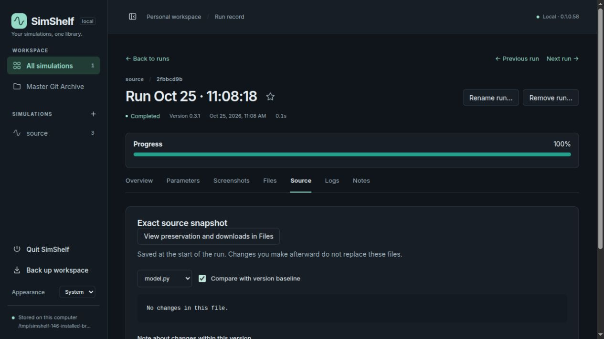
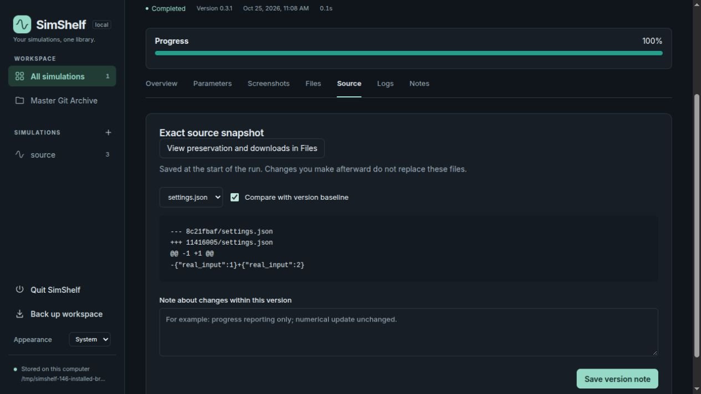
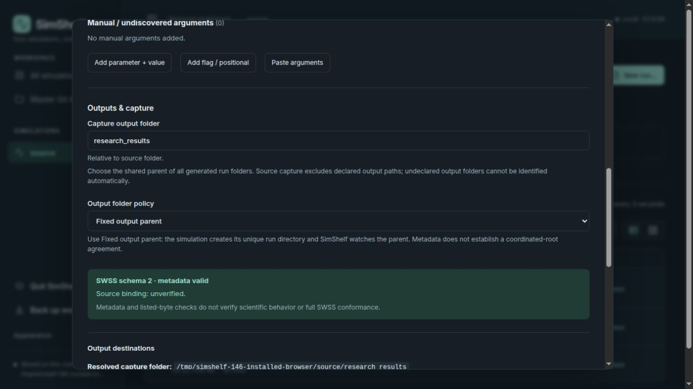

# Issue #146: generated outputs and source comparison

Implementation base: accepted `main` at
`dfdc4a841933a98d00b291b5688a946b5c67d72f`; application build `0.1.0.58`.
All execution and write checks used disposable standard-library fixtures and
libraries outside the checkout. No owner scientific code was executed.

## Reproduction and decisions

A small SWSS schema-2 script creates unique children under `research_results`,
copying its entrypoint and writing JSON/log outputs. Registration declares that
parent, while a launch override watches `research_results/current_capture`.
Before the fix, the override replaced the only source exclusion boundary. The
second run's source contained a previous child's copied `model.py` and
`summary.json`. The real entrypoint bytes were unchanged, but the added paths
changed both source and structure hashes.

The clean baseline snapshot was
`78222c23283f87ac1adc27f846f5a3e3d4a1511de3b982b50861ffaa42c3e5f6`;
the contaminated second snapshot was
`eaf3922f1f164581a8d8e7d5fcf0fc70d20682eb34d111094bfea493d3f1e760`.
With the fix, two further runs in that disposable library both produced the
original clean snapshot and structure hashes. Historical records were retained.

Source capture now retains the registered parent across overrides and excludes
registered, saved, current and associated supported local SWSS capture paths.
It canonicalizes containment and prunes directories before reading, parsing,
hashing or storing source blobs. Internal aliases exclude their real targets;
root/escaping aliases are refused. Similarly prefixed paths and legitimate
directories named like runs remain source. There is no snapshot format or hash
algorithm change, history repair, data deletion or workspace migration.

The warning now says **Captured source changed within version**. Non-Python
configuration/JSON source changes legitimately change structural comparison;
an unchanged Python entrypoint alone does not establish unchanged source.
Comment-only Python edits still classify as text-only.

## Reported standalone configuration and SWSS boundary

The owner supplied a path to one unique child of `runs_free_collapse_v0_2`.
Read-only inspection of its root companion and the matching registration's
capture preferences found no local SWSS capture declaration; registered and saved
capture paths were both `outputs`. Thus that standalone output parent was
undeclared. Only the root companion and relevant capture/source preferences were
read; the owner's source, database, outputs and saved settings were not changed.

This fix cannot automatically identify that undeclared tree. The owner must
review **Capture output folder** and explicitly select the shared
`runs_free_collapse_v0_2` parent, rather than an individual run child. Old snapshots
that already contain outputs remain immutable and can still compare differently
from a new clean snapshot. Do not relabel or replace the old baseline to hide it.

The accepted normative SWSS v2.0 specification was checked at
[`285ab0d6c06cc3b88e421a2c00577e72c650c750`](https://github.com/mongstad/Simulation-Standards/blob/285ab0d6c06cc3b88e421a2c00577e72c650c750/standards/SWSS/v2.0.md).
Its source-boundary requirement excludes generated outputs, but schema 2 defines
no portable output-parent field. This implementation uses existing local capture
configuration only; it does not infer ownership from portable argument defaults
or names, change argv, or introduce a portable contract. Automatic cross-tool
output-parent discovery would require a separately authorized Simulation-Standards
proposal, with source/capture/provenance compatibility and conformance boundaries
defined there. No standards repository changes were made.

## Validation

Python checks used `PYTHONPATH=src`, `PYTHONDONTWRITEBYTECODE=1`, the existing
SimShelf environment's Python, `pytest -q -p no:cacheprovider`, and separate
`--basetemp` directories under `/tmp`:

- Initial focused run: **64 passed** across `test_source_output_boundaries.py`,
  `test_swss_output_policy.py`, `test_isolated_outputs.py`,
  `test_swss_versions.py`, and `test_version_edge_cases.py`.
- Final boundary file after adding failure/association cases: **22 passed**.
  Coverage includes SWSS fixed and ordinary fixed/per-run capture, flat/nested
  roots, overrides, pre-existing copied Python/JSON and an oversized output file
  that must never be source-read, associated local and saved roots, real source
  changes, comment-only edits, unsafe aliases, exact argv, complete capture,
  historical bytes/rows, backup/restore and actual Git archive categories/downloads.
- Adjacent provenance/backup/version/removal-start checks: **41 passed** across
  `test_git_provenance.py`, `test_capture_backup.py`,
  `test_application_version.py`,
  `test_removal.py::test_snapshot_start_is_protected_from_deletion`, and
  `test_simulation_removal.py::test_active_and_pending_start_race`.
- Installed wheel: **51 passed** across the final boundary file,
  `test_swss_output_policy.py` and `test_isolated_outputs.py`, importing the
  disposable installed package rather than checkout sources.
- Frontend TypeScript check and production asset build passed; distributed
  JavaScript rebuilt. Application-version gate against `origin/main` passed.
- Built wheel and sdist in a disposable packaging environment, rebuilt a wheel
  from extracted sdist, and compared all **36 Python/static package files** with
  checkout bytes. Package metadata reported `0.1.0.58`. No release was published.
- Installed import, CLI version, workspace initialization, OpenAPI and static
  serving passed with Git and Node absent from `PATH`.

One new archive-test assertion initially failed because it assumed empty process
logs live in the source/output blob store. It was corrected to use the archive's
candidate-byte API; the final archive/download checks passed. An overly narrow
`-k` selection deselected adjacent tests; they were rerun explicitly in the
41-test batch. Starlette's existing TestClient deprecation warning remained.
API suites required execution outside the sandbox because of the known local
TestClient stall. No scientific interpreter dependencies were installed/changed.

## Installed browser evidence

The installed wheel served a temporary library on loopback. Three real wrapper
runs of a tiny fixture completed: baseline, unchanged repeat, then a legitimate
`settings.json` edit. Source contained only `model.py`, `settings.json` and
`swss.toml`; generated copies/JSON stayed out. The repeat showed no source diff.
The third run showed the captured-source warning, no entrypoint diff, and the
expected JSON diff. The New run form attached the shared-parent explanation to
**Capture output folder**. No simulation was started from the browser.
The browser console contained no captured warnings or errors.

## Limitations and owner verification

These checks are implementation evidence, not scientific/SWSS conformance or
solver certification. The owner's VB FreeCollapse simulation was not executed.
Windows, macOS, network filesystems, all themes and narrow/mobile browser layouts
were not tested. Undeclared output trees and external independent writers cannot
be identified/attributed safely. A historical contaminated baseline remains
different by design.

1. In New run, review the simulation's actual output arguments and choose the
   shared generated-output parent. For the reported setup this is
   `runs_free_collapse_v0_2`. Keep fixed-parent capture for SWSS, validate and save
   explicitly. Confirm resolved paths/coverage before starting scientific work.
2. First use a disposable tiny SWSS fixture with a fresh library/version baseline.
   Create multiple unique child directories containing a copied entrypoint and
   JSON, including one before the first run. Launch twice without editing source.
   Confirm both complete and Source omits every generated child; comparison is
   unchanged. Check exact argv and Files output downloads.
3. Change a legitimate helper or JSON input without touching the entrypoint.
   Confirm the source warning and the corresponding file diff. Make a Python
   comment-only edit and confirm text-only classification.
4. With Git archive configured, verify source/output categories and downloaded
   output bytes. Open old runs and verify original source manifests, names,
   annotations, archive commits and outputs are still available unchanged.
   Compare a new clean run against an old contaminated baseline honestly; do not
   expect its historical source classification to be rewritten.
