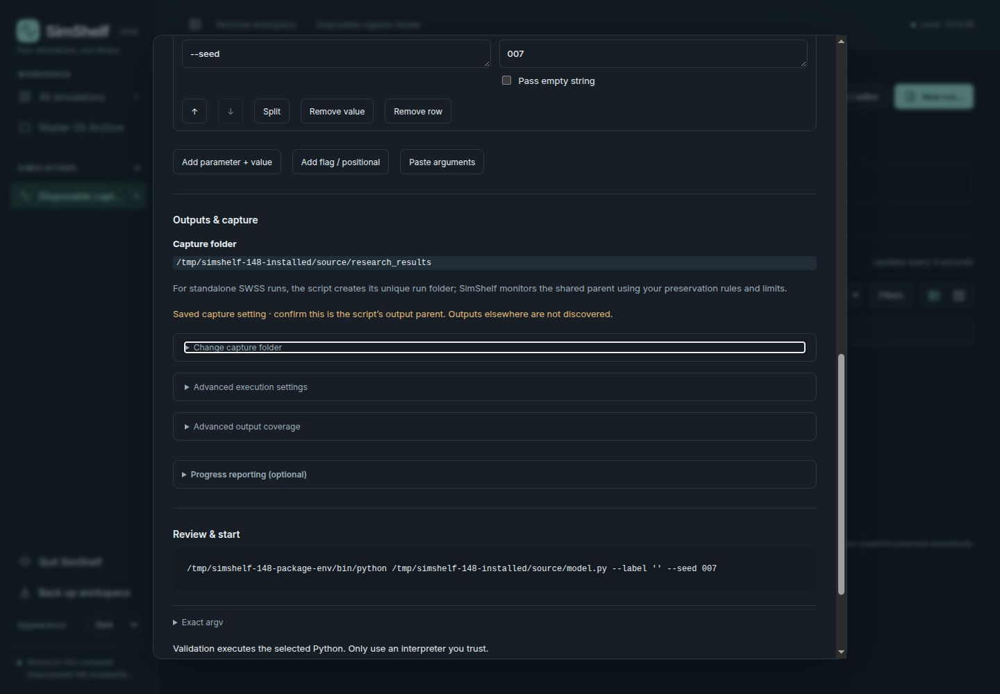
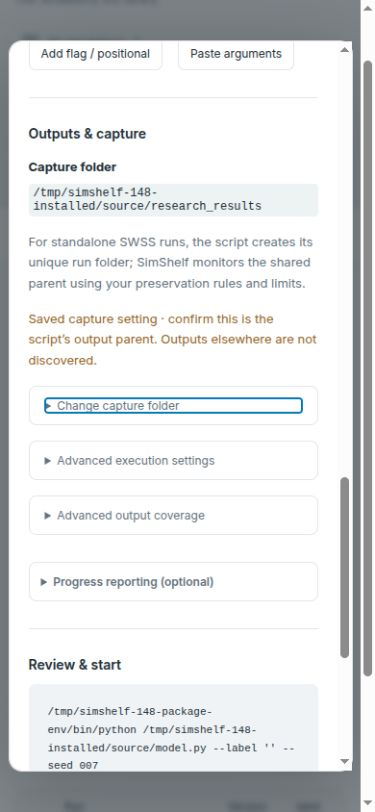

# Issue #148: New run output and capture settings

Validated on 2026-10-25, Linux, Python 3.14.8 and the Chromium in-app browser.
Accepted base: `efe88bc8e4804dbc90f2cdee2b53b62ec12b2ca5` (`0.1.0.58`).
Proposed application build: `0.1.0.59`.

## Scope and decisions

The Project board's only Ready issue was #148. Its existing linked branch was
clean and identical to accepted main. #146/PR #147 and #120 were merged;
the completed #146 branch was already absent locally and remotely.

Outputs & capture now presents one effective monitored path with an explicit
review/coverage status. Change capture folder provides the editable override;
Advanced execution settings holds CWD and the legitimate non-SWSS coordinated
policy. Advanced output coverage holds optional declarations. All are initially
collapsed. Mapping errors, unfinished declarations, outside-coverage warnings,
capture errors and the launch acknowledgement remain visible/discoverable.

SWSS runs no longer display an unavailable allocation choice. A saved incompatible
`per_run` value remains blocked until the user explicitly chooses Use fixed output
parent and validates/saves. No automatic correction or settings migration occurs.
The default CWD remains `.`. Capture remains source-root-relative, independently
of CWD. Declarations inspect coverage; they neither redirect writes nor add capture
roots. Files on external storage outside capture are not collected automatically.

Simulation-Standards #38 was closed by merged PR #39 at
`b1b5857eee9c7230dabc4298b40e92b578d7dafa`. Its README still identifies v2.0/schema 2
as current; the v3.0/schema-3 output-location material is explicitly a proposal.
The accepted v2.0 specification has no portable output-parent field. This change
does not adopt the proposal or infer `outputs/` from metadata. Saved paths remain
settings requiring review against the script's actual writes; fresh capture
settings explicitly say they need review.

Runtime edits are confined to frontend presentation and the application build.
Exact argv, request bodies, process execution, storage schema, scientific source,
output allocation, capture, backups and archive behavior retain their contracts.
Historical reports and images are unchanged.

## Automated validation

- TypeScript check and production build passed using the bundled Node runtime
  with `pnpm run typecheck` and `pnpm run build`. Distributed JS/CSS rebuilt;
  third-party license files unchanged. `npm` was unavailable; no installation
  or dependency changes were needed for frontend work.
- **33 frontend tests passed**: `outputs.test.mjs` (7), `arguments.test.mjs` (4),
  `parameters.test.mjs` (20), and `themes.test.mjs` (2). The first three were
  bundled with esbuild to disposable CommonJS files and executed with Node;
  themes ran directly. Running bundles directly exposes individual test counts.
- **81 source Python tests passed**, using `PYTHONPATH=src`,
  `PYTHONDONTWRITEBYTECODE=1`, `pytest -q -p no:cacheprovider`, and a `/tmp`
  `--basetemp`: `test_source_output_boundaries.py`, `test_output_paths.py`,
  `test_swss_output_policy.py`, `test_isolated_outputs.py`, and
  `test_application_version.py`.
- The **same 81 tests passed against the installed wheel**, without checkout
  `PYTHONPATH`, from `/tmp`. Installed imports resolved under the disposable
  package environment. Covers repeated real captures, output/source boundaries,
  external/symlink safety, argv, consent, historical preservation and backup.
- Version gate against `origin/main` and `git diff --check` passed.

The source test attempt stalled at the documented sandbox/TestClient boundary
and was interrupted. Both complete batches ran outside the sandbox on disposable
fixtures. The source batch emitted the existing Starlette TestClient deprecation
warning. The initial loopback server attempt was also denied by the sandbox and
was rerun outside it.

## Browser and packaged runtime

The updated `scripts/test_swss_output_browser.mjs` harness passed **10 cases at
1440 × 1000 and 390 × 844**. It checks hidden inapplicable controls, explicit stale
policy correction, rescan invalidation, unavailable metadata/manual fallback,
failed refresh, spacing, CWD/capture independence, unsaved override review,
external acknowledgement after collapsing coverage, exact save/launch payloads,
capture errors without stale paths, and fresh settings without inferred defaults.
Requests in this harness are fixtures and execute no scientific code.

The existing polish fixture passed ready, required, blocked, manual and progress
migration-consent scenarios across Dark, Light, Onyx, Slate and Linen. This was
scenario coverage across palettes, not every state/size/theme permutation.
Enter toggled native capture disclosures; CWD and capture overrides remained
editable. Installed Dark desktop and Light narrow dialogs had no horizontal
overflow (983/983 and 341/341 client/scroll widths). No installed browser warnings
or errors were captured.

Wheel, sdist and a wheel rebuilt from extracted sdist were built from a disposable
source copy. Metadata agreed on `0.1.0.59`; all **36 Python/static package files**
in both wheels matched checkout bytes. Build tools were installed only into
`/tmp/simshelf-148-package-env`; the first build attempt lacked `build` there,
then passed after adding it. Installed runtime checks reused existing development
dependencies through a temporary environment-local `.pth`, rather than claiming
a fully fresh dependency installation. Import, CLI version, workspace creation,
OpenAPI and UI/static serving passed with Git and Node absent from PATH.

A final archive-content assertion expected nested validation screenshots and
failed: the existing sdist manifest includes Markdown reports and only the three
root README preview images. These new nested screenshots are repository evidence,
not shipped package data. The final rebuilt wheel still matched all 36 runtime
files. Packaging policy was not broadened for this UX issue.

Two real browser launches of a tiny standard-library SWSS fixture completed in
`/tmp/simshelf-148-installed/library`. Both used fixed shared-parent capture at
`research_results`, with the script creating its unique child. Exact argv retained
`["--label", "", "--seed", "007"]`; copied JSON matched those tokens and copied
log bytes matched the closed fixture log. Both snapshots contained only
`model.py` and `swss.toml`, with identical snapshot IDs and baseline/same status.
Generated outputs remained outside source. No owner scientific script was run.

Validation setup incident: the first installed-server invocation omitted
`SIMSHELF_HOME` and briefly initialized the default
`~/.local/share/simshelf` library. It was stopped immediately; read-only inspection
verified zero simulations and zero runs. It was left untouched. The replacement
server explicitly used the `/tmp` library. No scientific records were present in
the accidentally initialized default library.

## Limits and owner verification

No arbitrary output discovery, external-root collection, source repair, schema-3
adoption, scientific conformance, release or publication is claimed. Windows,
macOS, other browser engines, network filesystems and scientific/GPU workloads
were not tested. Source/output/archive integrity relies on the unchanged backend
and its focused regression coverage; historical evidence was not rewritten.

1. Open New run for a schema-2 SWSS simulation. Confirm one effective capture
   destination, no unavailable policy selector, and initially collapsed settings.
   Review the actual script output parent; a saved `outputs` path is not proof.
2. Change capture folder to the shared parent, such as `research_results`.
   Expand Advanced execution settings and confirm CWD remains `.` unless edited.
   Validate/save explicitly and inspect Exact argv.
3. Launch a disposable tiny simulation twice. Verify distinct original run children,
   complete copied log/JSON bytes, identical real-source snapshots and no generated
   siblings in Source. Check existing historical runs remain unchanged.
4. With a plain script supporting the existing adapter, confirm the coordinated
   option remains under Advanced execution settings. With invalid/stale metadata,
   confirm manual fixed-parent fallback and actionable diagnostics.
5. Set the script's own external output argument; declare that absolute path in
   Advanced output coverage. Confirm the outside-coverage warning survives collapse
   and Start requires acknowledgement. Keep an independent backup of external files.
6. Check Dark/Light on a narrow screen; open/edit disclosures by keyboard and
   verify edits invalidate validation and acknowledgement before launch.
