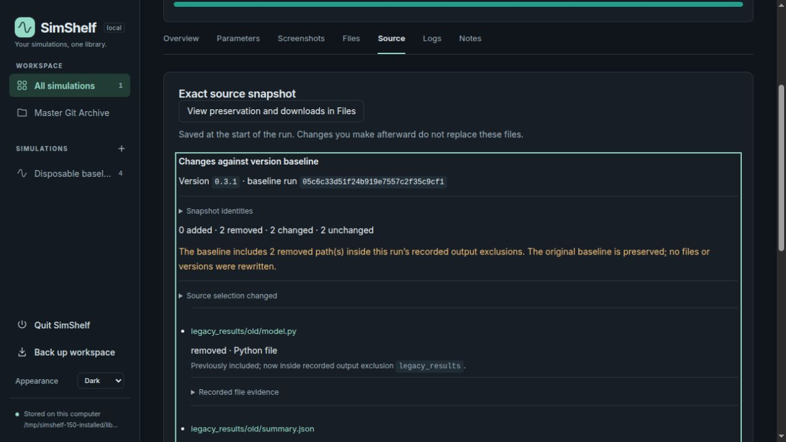
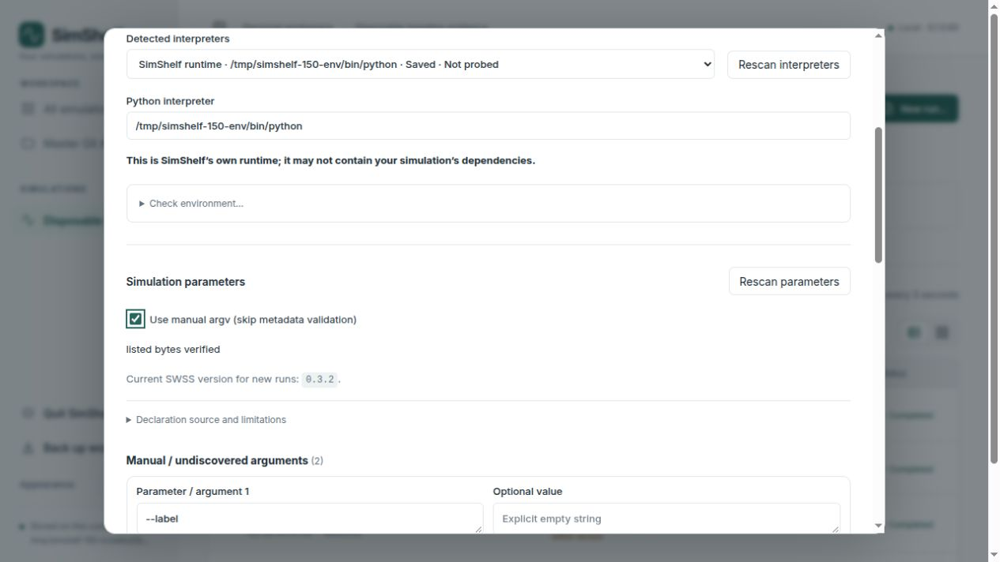
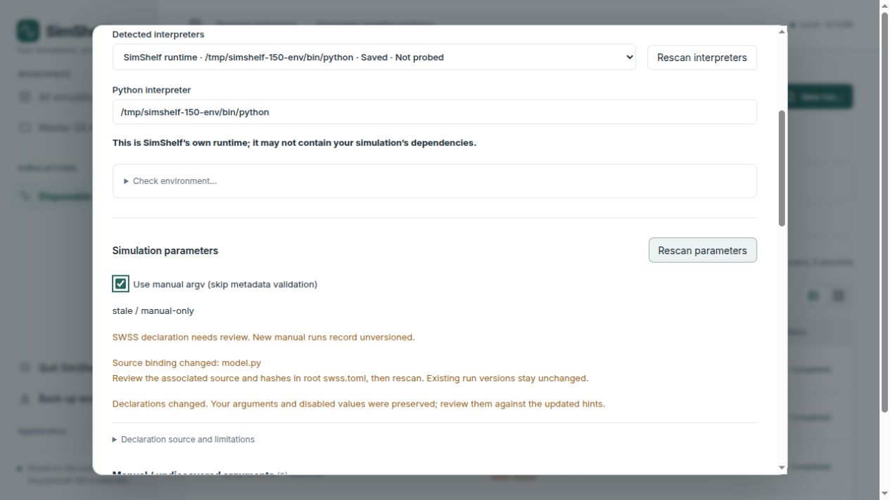

# Issue #150: explain recorded versions and source baselines

Validated on 2026-10-25, Linux, Python 3.14.8 and Chromium in-app browser.
Accepted base: `2c3b573247a59be868802fb6a6e3a1feb8e202f3` (`0.1.0.59`).
Proposed application build: `0.1.0.60`.

## Investigation and demonstrated defects

#150 was the only Ready Project item. Its existing linked branch was clean and
identical to accepted main. #146 and #148 were merged; the completed #148 branch
was already absent locally/remotely. Historical validation evidence was preserved.

The version trace is:

1. `swss.read` reads one associated root companion, validates schema 2 and hashes
   listed source bytes as data. The declaration owns `simulation_version`;
   Python `VERSION` and `SIMSHELF_VERSION` do not override accepted SWSS metadata.
2. `swss.review` rechecks discovery and typed fingerprints during validation and
   launch. `Run.__enter__` checks companion bytes against captured source and
   rejects observed bound-source mutation during capture.
3. A valid declaration supplies the new run version; stale/invalid metadata on
   explicit manual runs records `unversioned` with diagnostics. Without a
   companion, the existing literal legacy tag fallback applies.
4. The start event selects the first extant run in the same simulation/version
   as the baseline and freezes its ID plus the whole-snapshot classification.
   An existing run retains that ID after baseline-run removal; removal's existing
   retained-snapshot/new-run baseline policy is unchanged.
5. Run rows and version history use the recorded version, not today's live file.

No defect in A/B attribution was reproduced. A valid A declaration recorded A;
an unchanged repeat was `same`; a valid B declaration established B's separate
baseline and left A unchanged. A metadata-only bump necessarily changes the
companion/source package bytes even when the Python entrypoint is unchanged.

The reproduced explanation defect was definitive: editing `settings.json` at the
same version produced `changed` while the entrypoint remained byte-identical.
The old UI had no whole-snapshot path list. Its per-file endpoint also refused
baseline-only removed paths, described permission-only changes as “No changes,”
and could treat an oversized baseline as empty. Empty-file and non-UTF-8 text
renderings could likewise conceal real manifest differences. These preview and
explanation defects are corrected. Version authority, canonical baseline choice
and source fingerprint algorithms were not redesigned.

The issue's reported entrypoint hash alone cannot identify differences in the
owner's full historical snapshots. No owner library or uploaded scientific fixture
was accessed in this task; the owner-specific cause remains to be inspected using
the new evidence view. No owner solver was executed.

## Implementation and integrity boundaries

- `source_comparison.py` adds a read-only, locked comparison against the recorded
  baseline. It checks manifest identity, lists all changed paths through pages
  of at most 200, includes both file hashes/sizes/modes, and classifies changed
  Python AST/text from retained bytes. AST work is capped at 1 MB/file and
  8 MB/page; unavailable/corrupt/oversized evidence stays explicit.
- `api.py` exposes the summary and preserves per-file byte integrity checks while
  supporting removed paths, permission-only evidence and non-text/empty changes.
  Neither comparison reads live scientific source or changes stored classifications.
- `source.py` fills an optional selection context during the existing snapshot
  operation; `recording.py` adds it only to new start-record JSON. Content-addressed
  snapshot format/bytes/IDs and historical runs/journals remain unchanged. No schema
  migration, source edits, history repair, output deletion or Git rewrite occurs.
- A new run's full context identifies removed paths within its actual recorded
  output exclusions. Historical capture settings support only a conservative
  “consistent with corrected output exclusion” explanation. Missing historical
  context is disclosed; filenames do not establish generated-file ownership.
- `SourceComparison.tsx` supplies paginated evidence, retry/error states and
  removed-path selection. Overview links focus this region by keyboard. Run
  version evidence is explicitly historical; ArgumentEditor shows the current
  future-run version and actionable stale-hash diagnostics. Exact argv, launch
  gates, settings, capture allocation, annotations and archive rules are unchanged.

## Validation

Source tests used `PYTHONPATH=src`, `PYTHONDONTWRITEBYTECODE=1`,
`pytest -q -p no:cacheprovider`, and disposable `/tmp` `--basetemp` directories.
TestClient batches ran outside the previously documented sandbox boundary.

- **98 tests passed** in the final focused batch: `test_source_comparison.py`,
  `test_swss_versions.py`, `test_version_edge_cases.py`,
  `test_source_output_boundaries.py`, `test_swss_output_policy.py`,
  `test_capture_backup.py`, `test_application_version.py`,
  `test_git_provenance.py`, and the retained-baseline backup/removal test.
  A subsequently added AST aggregate-budget regression also passed (**1 test**).
- The final installed wheel passed the complete expanded **99-test** batch from
  `/tmp`, without checkout `PYTHONPATH`, including that aggregate-budget case.
- Coverage includes actual portal A/repeat/B/repeat launches with and without a
  Python edit plus updated manifest, conflicting Python version tags, metadata-only
  bumps, helper/config changes, stale bindings/manual fallback/typed refusal,
  repeated fixed-parent output exclusion, exact argv and captured JSON/log bytes.
  Comparison tests check all path categories, comments/structure, permission changes,
  selection changes, old records without context, baseline deletion/backup restore,
  206-path pagination, missing/corrupt evidence, preview/AST budgets and non-UTF-8
  rendering. Stored run rows and managed snapshot/blob/journal bytes stay unchanged.
- **28 frontend tests passed**: recorded-version evidence (2), arguments (4),
  parameters (20) and themes (2). TSX/extensionless tests were bundled with esbuild
  to disposable CommonJS files and executed directly with Node.
- TypeScript, production build, version gate and diff checks passed. Distributed
  JS/CSS rebuilt; license notices unchanged.
- Browser component harness: **4 cases passed**, covering canonical/deleted
  baseline evidence, safe path rendering, removed-path selection, pagination,
  failures/retry and late old-run responses. Launch harness: **10 cases passed**,
  including future-run version labeling and manual-unversioned diagnostics.
  The healthy full-App Overview/Files/Source/focus regression passed.

Initial test development exposed a fixture error: replacing the entrypoint also
removed its legacy version tag, legitimately creating an unversioned baseline.
The fixture now mutates a helper, preserving its version. The initial batch was
45 passes/1 failure; the corrected focused batch was 47 passes. A browser harness
initially clicked pagination before React effects settled; its act boundaries were
corrected and all four cases passed. The existing Starlette TestClient deprecation
warning remains. These were test-fixture failures, not hidden product passes.
One disposable fixture server stopped during extended QA and was restarted.
A later browser error page persisted despite healthy loopback responses; a fresh
background tab recovered. Earlier successful browser checks were retained and
the comparison harness was checked again against final assets.

## Installed runtime and browser evidence

Wheel/sdist/rebuilt-wheel validation used an external source copy and disposable
environment, reusing existing build tools and runtime dependencies without changing
the development/scientific interpreter. Both wheels contained **37 Python/static
files** matching checkout bytes; metadata reported `0.1.0.60`. Installed import,
CLI, workspace, OpenAPI, static/UI serving and comparison worked with Git and Node
absent from PATH. All server starts explicitly selected the `/tmp` library.
Nested validation screenshots remain repository evidence under existing sdist
rules; no publication or release was performed.

A tiny standard-library fixture created unique output children. Four installed
recordings established A, a same-version corrected-boundary/input-change record,
B from a metadata-only bump, and an unchanged B repeat. A's Python `VERSION` literal stayed A
while accepted B metadata governed new runs. The A baseline intentionally contained
two undeclared old output files; correcting the reviewed boundary excluded them.
The comparison showed **2 removed, 2 changed, 2 unchanged**: removed old Python/JSON,
real `settings.json` bytes and `mode.py` permissions. The real entrypoint preview
said “No changes in this file”; selecting removed JSON showed its deletion diff.
B used its own baseline, and its repeat had no differences. Old run records stayed
unchanged. New run displayed `0.3.2` for future runs while history retained A/B.

A temporary hash mismatch in the disposable companion produced visible
`Source binding changed: model.py`, review/rescan guidance and manual-unversioned
wording. No run was launched from that dialog. Exact version-B companion bytes
were restored afterward. No browser warnings/errors were captured.

Desktop Dark/Light screenshots and keyboard focus were verified. The browser's
viewport override did not resize the documents: measured widths remained 1280
or 1440 despite a 390-width request. Narrow/mobile behavior is **unverified**;
the repeated harness passes under that request are not counted as mobile evidence.

## Limitations and owner checks

AST classification is an advisory comparison under the running Python parser,
not scientific equivalence. Snapshot manifests reveal recorded paths/bytes/modes,
not the cause of every addition/removal. Old selection context and deleted-run
context can be incomplete. Historical classifications are retained even if parser
or environment changes explain different structural fingerprints. Preview/budget
limits are explicit; use retained downloads for larger files.

No owner data, GPU/solver behavior, Windows/macOS, other browser engines, network
filesystems, every theme permutation or mobile layout was tested. Current SWSS
v2.0/schema 2 remains authoritative; the v3 proposal is not adopted. No optional
alternate comparison or rebaseline feature was added.

1. Open an affected existing run. Check **Run version (recorded at start)**, then
   choose **Inspect changed paths**. Confirm the actual baseline run/snapshot IDs.
2. Inspect all added/removed/changed paths, not only the entrypoint. Expand file
   evidence for both hashes/modes. Select a baseline-only path to view deletion.
   For old output trees, distinguish a recorded exclusion from a merely consistent
   historical capture setting; do not repair or relabel old snapshots.
3. On a disposable fixture, record A twice. Change the associated companion to B;
   if Python changed, update its manifest hash deliberately. Record B twice. Check
   A stays A, B establishes a separate baseline, and unchanged repeats match.
4. In that disposable fixture, change a helper/JSON input at the same version as a negative case: inspect the
   warning and exact path evidence. Test a comment and a permission change.
5. Make a disposable stale-hash case. Confirm the affected path and rescan guidance,
   typed refusal, and explicit manual-unversioned behavior. Restore source/hash
   declarations deliberately before scientific work; SimShelf edits none of them.
6. Confirm New run's current version applies to future runs while old history stays
   unchanged. Independently check narrow/mobile layout and the owner's scientific
   environment, which this validation does not certify.
